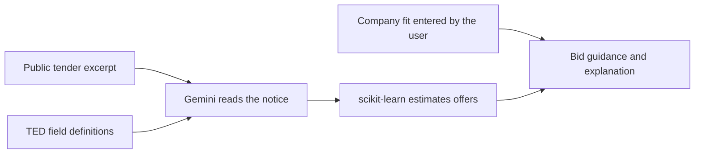

# Tender Desk | Group assignment report

- **Team** (Blackboard group name) — to be confirmed
- **Section** — to be confirmed
- **App URL** (on Render) — https://construction-tender-desk.onrender.com/
- **Final commit** (tag `final`) — pending team evaluation

## Business case

A bid manager at a Spanish construction contractor must decide which public
works tenders justify the cost of preparing a proposal. The manual baseline is
to read the published notice, check eligibility and capacity, then look at
past awards for an idea of the competition. Tender Desk brings the notice
facts and an estimate of offer volume into one screen.

The proposed success metric is **screening minutes saved per notice while
preserving the opportunities a human reviewer would shortlist**. A team
member can time the manual and assisted workflow on the same notices and
compare their decisions with the team's pre-labeled decisions.

| Illustrative assumption | Value |
|---|---:|
| Notices screened per month | 40 |
| Time saved per notice | 15 minutes |
| Analyst cost | €35 per hour |
| Gross time value | 10 hours, or €350 per month |

This scenario excludes human rechecks, hosting and any opportunity lost from
passing on a good contract. The figures are assumptions for the team to test.

## Architecture

**Component 1: agentic LLM.** Gemini 3.5 Flash-Lite calls a procurement
reference tool, then returns schema-validated fields. Unknown fields stay
unknown. Gradio accepts Spanish or English notice text.

**Component 2: tabular ML.** The estimator uses the CPV group, pre-award
budget, duration, buyer type and award basis. The app combines the estimate
with the user's assessment of eligibility. The recommendation, extracted
facts and historical error range appear together. The Monitoring tab shows
request volume, review rate, feedback, latency and estimated cost.

The app uses the course template for the Gradio entry points, logging,
monitoring and submission checker.

## Data

The European Commission's TED CSV files provide both the calls for
competition and the linked awards. The training target is the number of
offers received, which may include joint bids. The budget is the published
pre-award estimate excluding VAT. The included table contains selected
non-personal fields and publication IDs. The app's example is a shortened,
contact-free excerpt prepared from the TED fields. The app logs structured
fields and never stores the pasted notice text. It removes recognizable
contact fields, email addresses, phone numbers and personal identifiers
on the app server before calling Gemini. The preview button lets a user check the
cleaned text for details that need manual removal. See the [TED CSV release](https://data.europa.eu/data/datasets/ted-csv),
[TED codebook](https://data.europa.eu/data-management/store/api/legacy/data/ted-csv-data-information-v3-6.pdf/)
and [TED reuse terms](https://ted.europa.eu/en/legal-notice).

| TED data or evaluation split | Records |
|---|---:|
| Spanish public construction calls, 2018–2023, CPV 45 | 2,567 |
| Unambiguous single-lot links with positive offer counts | 1,285 |
| Final model fit, with offers available by end of 2022 | 886 |
| 2022 validation subset used to choose the model | 132 |
| Held-out 2023 calls with linked offers and complete model inputs | 134 |

The final training set includes the validation cohort after model selection.
The cohort represents the successfully linked cases in TED and is limited to
open procedures with usable budget and duration for model fitting. It can
underrepresent smaller or unpublished contracts and calls without an award.

## Evaluation

### Components

The Gemini field extraction check compares each populated field against the
team's manual label. A live smoke run on TED notice 202807-2023 extracted
the €6,213,852.81 budget, 18-month duration, CPV 45233000 and open single-lot
procedure. Its estimate was 16 offers. The linked award reported 12. This
is one worked example.

The count estimator was selected on 2022 validation error from a gradient
boosting model and a random forest. Mean absolute error (MAE) is measured in
offers. The baseline predicts the median offer count of the fitting data for
every tender. The selected model was then assessed on 2023 cases.

| Model | 2022 validation MAE | 2023 holdout MAE |
|---|---:|---:|
| Historical median | 5.62 | 4.87 |
| Gradient boosting | 5.88 | 4.75 |
| Random forest | 6.61 | — |

The gradient boosting estimate was within nine offers for 90.3% of the
holdout. It slightly improved on the median in 2023 while trailing it in
2022. The interval is a historical error band.

### End to end

The team labels at least 30 excerpts before inspecting the app's output.
Compare decision accuracy against a manual review and report field accuracy,
offer-count error, correct review routing and the overall success rate.
Structured facts and decision codes are scored directly. Keep the actual
recorded offers in the expected-answer column, separate from the tender
input. See the [evaluation format](eval/README.md).

The local smoke runs exercised a real Spanish roadworks case, an
out-of-scope case and a company that failed a mandatory requirement. The
team's 30-case results are pending.

### Cost and latency

Four successful local runs of the same TED example recorded a median of
1,157 tokens, €0.00051 in estimated API cost and 11.06 seconds end to end.
At the same cost per request, 40 requests would cost about €0.02 in model
calls. This is a small repeatability check. The tabular estimator runs
locally and incurs zero API token charges. Team evaluation will measure
latency and cost across varied excerpts. See [Gemini pricing](https://ai.google.dev/gemini-api/docs/pricing).

## Operations

Each request records its length, model and prompt versions, controlled
fields, decision, token count, estimated cost, latency and optional user
feedback. Render persists Tender Desk logs in separate Postgres tables. Review rate is the primary quality signal. The dashboard compares
input features against a reference set using the population stability index
(PSI). The alert threshold is the greater of 0.25 and twice the expected
sampling noise, with a 20-request minimum in the dashboard. This avoids
flagging small swings in short windows. The team should validate the rule on
its own reference and shifted excerpts.

The monitored feature is the share of explicit primary CPVs outside
construction. A practice replay used 30 distinct Spanish construction
reference excerpts. It stayed quiet on 14 normal construction cases
(PSI 0.000, threshold 0.838) and alerted on 10 Spanish cleaning notices
(PSI 18.419, threshold 1.067). This tests a sector shift with country held
constant. It measures the behaviour of the drift rule and does not measure
a change in model accuracy. The team will rerun the check on its final
normal cases. The live dashboard needs 20 recent requests with an explicit
primary CPV to evaluate the alert.

## Failures

Two local smoke requests hit Gemini service failures and returned manual
review. The SDK retries transient errors with the same configured model.
If extraction still fails, the app records the failed request and opens
the review path without an offer estimate. This keeps model availability
separate from the decision about whether to bid. An out-of-scope notice also went to review as designed. The
historical error band is wide enough for low and high offer counts to
overlap on some tenders. The next evaluation should count extraction
failures, missing source fields, unsupported notices and large prediction
errors separately. This will show whether the better use of the tool is
document screening, competition estimation or both.

## Decision

The current prototype is suitable for a **human-reviewed screening demo**.
It shows the estimate on eligible notices and routes unsupported or
uncertain cases to review. A user who confirms that their company fails a
mandatory requirement can receive a no-bid recommendation. Automatic
shortlisting stays gated because the estimator trailed the median on the
validation set.

The team will make its final go/no-go decision from the labeled evaluation,
review workload and measured time saved. For a 40-notice month across
20 working days, reviewing every notice would mean two reviews per working
day. Replace that scenario with the observed review rate when results are in.

## Presentation

Open the Render app a few minutes early. Show one live normal case, a
separate case that goes to review, and the Monitoring tab. The TED example
button fills the form immediately. Selecting **Analyse tender** calls
Gemini and can take longer. Record a backup of that same flow in case the
network fails. See [Render's free-tier behavior](https://render.com/docs/free).

## How to run it

Copy `.env.example` to `.env`, set `GEMINI_API_KEY`, and run
`uv run python app.py`. Select **Load TED example**, then **Analyse tender**.
The bundled model requires no data download to run. Training, drift checks
and deployment are documented in [SETUP.md](SETUP.md#tender-desk-data).

## AI use

Codex assisted with code, UI design, data preparation, smoke testing and the
report draft. The team selects and labels the evaluation cases, interprets
the results and owns the final release decision.
